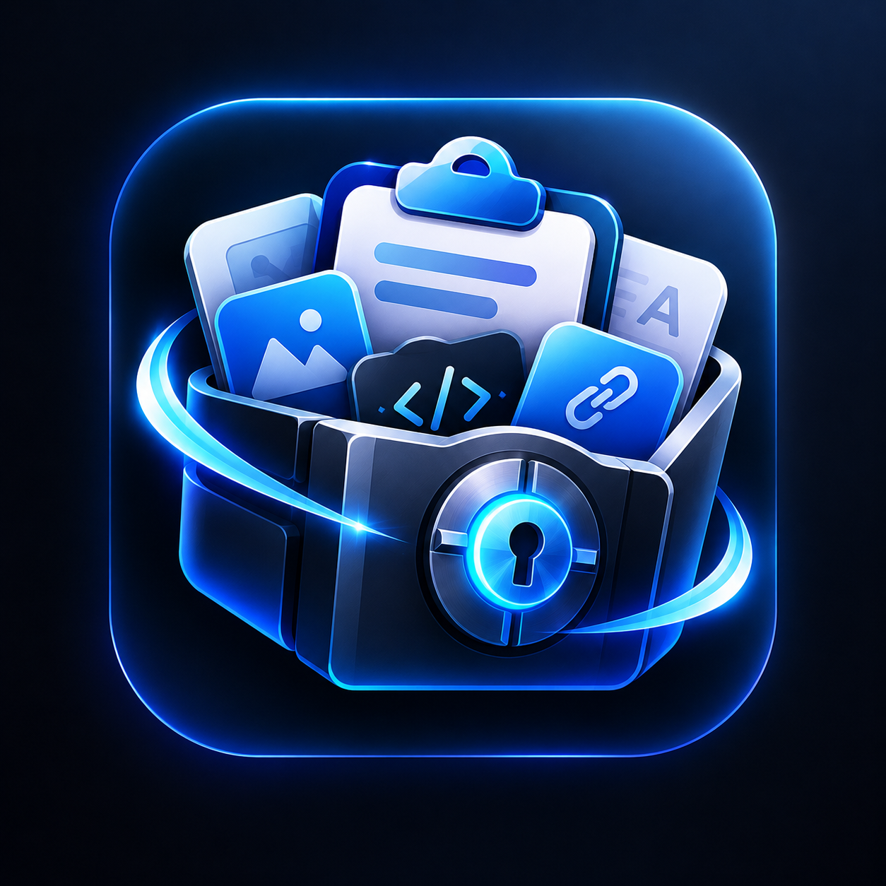
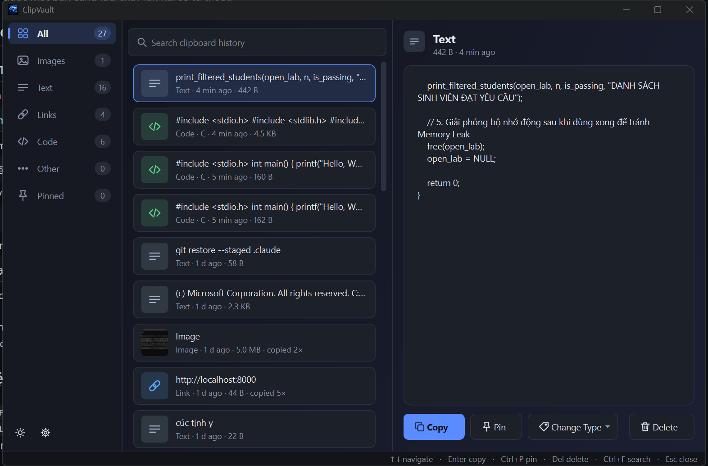
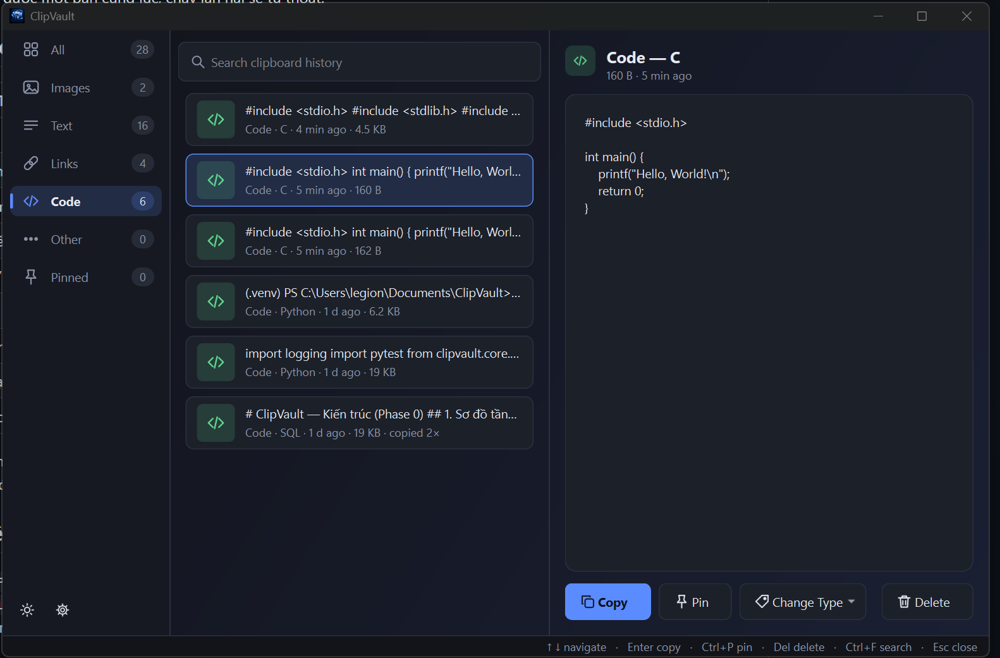
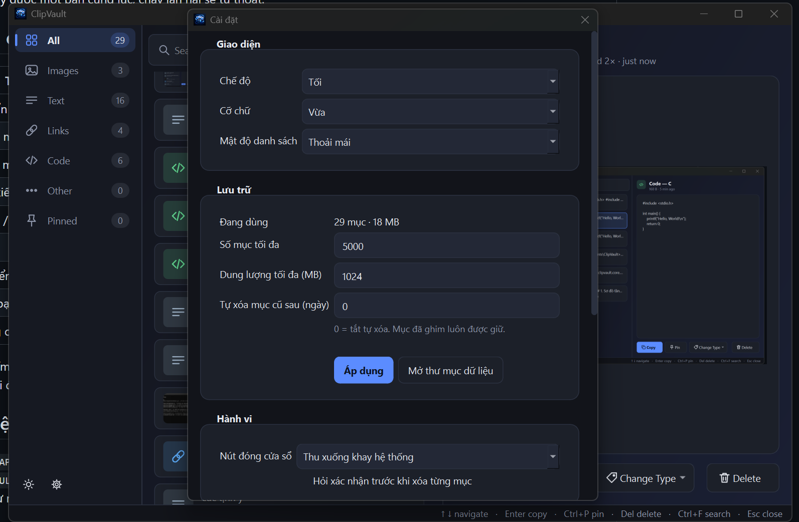

<div align="center">



# ClipVault

**Trình quản lý clipboard cho máy tính để bàn.**
Lưu lịch sử text và ảnh bạn đã copy, tìm lại nhanh, ghim mục quan trọng và copy lại đúng định dạng gốc.




</div>

## Điểm nổi bật

- **Riêng tư tuyệt đối:** mọi dữ liệu nằm trên máy bạn. Không gọi mạng, không ghi nội dung clipboard vào log.
- **Giữ nguyên dữ liệu gốc:** copy lại dán được y như lúc đầu, phân loại không bao giờ sửa nội dung.
- **Tự phân loại:** Images, Text, Links, Code (kèm tên ngôn ngữ), Other (email, màu, đường dẫn...).
- **Nhanh:** tìm kiếm tức thì, phím tắt toàn cục, chạy nền ở khay hệ thống.

## Tính năng

| | |
|---|---|
| 📋 **Tự động bắt** | Text và ảnh khi bạn copy; mục trùng chỉ cập nhật thời gian, không tạo bản sao. |
| 🏷️ **Phân loại** | Tự nhận diện loại nội dung; đổi thủ công bằng *Change Type*. |
| 🔍 **Tìm kiếm** | Lọc tức thì theo nội dung, kết hợp với các danh mục ở sidebar. |
| 📌 **Ghim** | Mục đã ghim không bao giờ bị dọn tự động. |
| 🖼️ **Thumbnail ảnh** | Xem trước ảnh ngay trong danh sách. |
| 🌗 **Giao diện** | Theme sáng/tối, cỡ chữ và mật độ danh sách chỉnh được trong Settings. |
| 🔒 **Bảo vệ mật khẩu** | Bỏ qua nội dung từ trình quản lý mật khẩu (các cờ riêng tư của hệ điều hành). |

## Ảnh chụp màn hình

<table>
  <tr>
    <td align="center" width="50%">
      <br />
      <sub><b>Danh mục Code</b>: tự nhận diện ngôn ngữ (C, Python, SQL...)</sub>
    </td>
    <td align="center" width="50%">
      <br />
      <sub><b>Cài đặt</b>: giao diện, giới hạn lưu trữ, hành vi</sub>
    </td>
  </tr>
</table>

## Cài đặt và chạy

Cần Python 3.12.

```powershell
python -m venv .venv
.venv\Scripts\python -m pip install -e ".[dev]"
.venv\Scripts\python -m clipvault              # mở cửa sổ
.venv\Scripts\python -m clipvault --background # khởi động ẩn, chỉ còn icon ở khay
```

> Chỉ chạy được một bản cùng lúc; chạy lần hai sẽ tự thoát.

### Đóng gói

- **Windows:** `powershell -ExecutionPolicy Bypass -File packaging\build.ps1` tạo `dist\ClipVault-Setup-<version>.exe` (PyInstaller + Inno Setup 6). Bản cài theo từng người dùng, không cần quyền admin; gỡ cài đặt không xóa dữ liệu.
- **macOS:** `packaging/build_macos.sh` tạo `.app` và `.dmg` (arm64), hoặc chạy workflow [macOS build](.github/workflows/macos.yml) trên GitHub Actions.

## Cách dùng

| Thao tác | Cách làm |
|---|---|
| Mở/ẩn cửa sổ | `Ctrl+Shift+V` hoặc click icon ở khay |
| Chọn mục | `↑` `↓` (cả khi đang gõ ở ô tìm kiếm) |
| Copy mục đang chọn | `Enter`, nút Copy, hoặc double-click, rồi `Ctrl+V` ở app khác để dán |
| Tìm kiếm | `Ctrl+F`, gõ chữ; `Esc` để xóa tìm kiếm |
| Ghim / bỏ ghim | `Ctrl+P` hoặc nút Pin |
| Xóa | `Del` hoặc nút Delete (mục đang ghim sẽ hỏi xác nhận) |
| Chuyển danh mục | Click sidebar hoặc `Ctrl+1` đến `Ctrl+7` |
| Đổi loại | Nút Change Type |
| Đóng cửa sổ | `Esc` hoặc nút X: app vẫn chạy nền. Thoát hẳn: chuột phải icon khay > Quit |

Đổi phím tắt toàn cục: ghi khóa `ui.hotkey` (ví dụ `Ctrl+Alt+K`) vào bảng `settings` của cơ sở dữ liệu.

## Lưu trữ và dữ liệu

| Giới hạn | Mặc định | Chỉnh trong Settings |
|---|---|---|
| Dung lượng mỗi mục | 20 MB | không |
| Tổng dung lượng | 1 GB | có |
| Số mục tối đa | 5.000 | có |
| Tự xóa theo ngày | tắt (0) | có (0 đến 3650 ngày) |

Khi vượt giới hạn, mục **chưa ghim** cũ nhất bị dọn trước. Mục đã ghim không bao giờ bị xóa tự động.

Dữ liệu nằm ở `%LOCALAPPDATA%\ClipVault\` gồm `clipvault.db` (lịch sử), `blobs\` (ảnh lớn) và `logs\`. Đặt biến môi trường `CLIPVAULT_DATA_DIR` để dùng thư mục khác (app từ chối thư mục nằm trong mã nguồn hoặc thư mục cài đặt). Xóa thư mục này để xóa toàn bộ lịch sử.

## Phát triển

```powershell
.venv\Scripts\python -m pytest -q
```

Test UI chạy không cần màn hình (Qt offscreen). Hai test ghi vào clipboard thật là tùy chọn vì chúng ghi đè clipboard của bạn:

```powershell
$env:CLIPVAULT_LIVE_CLIPBOARD = "1"; .venv\Scripts\python -m pytest -q tests/test_windows_adapter.py
```

Cấu trúc (chi tiết trong [docs/ARCHITECTURE.md](docs/ARCHITECTURE.md)):

```
src/clipvault/
  core/        model, ports (Protocol), limits, paths: dùng chung, không gọi API hệ điều hành
  storage/     SQLite + blob store
  classifier/  phân loại (thuần, chỉ đọc)
  engine/      capture, dedupe, retention, lịch sử, paste-back
  ui/          PySide6: cửa sổ, model/view, theme, tray
  adapters/    windows (ctypes Win32) và macos (pyobjc); nơi duy nhất được import API hệ điều hành
tests/
```

Tiến độ và quyết định kiến trúc: [PLAN.md](PLAN.md). Quy tắc làm việc trong repo: [CLAUDE.md](CLAUDE.md).

## Giới hạn hiện tại

- Mới lưu text và ảnh (PNG, bitmap); chưa lưu HTML/RTF/danh sách file.
- Copy chỉ đặt dữ liệu lên clipboard, chưa tự gửi `Ctrl+V`.
- Tìm kiếm chưa bỏ dấu tiếng Việt ("chao" không khớp "chào").
- Phân loại dựa trên quy tắc nên có thể nhầm; dùng Change Type để sửa.
- Cơ sở dữ liệu không mã hóa; bảo vệ bằng quyền thư mục của người dùng.
- Bản cài Windows chưa ký số nên SmartScreen có thể cảnh báo.
- **macOS:** code và đóng gói đã viết nhưng **chưa chạy trên máy Mac thật**; chưa ký/notarize.
